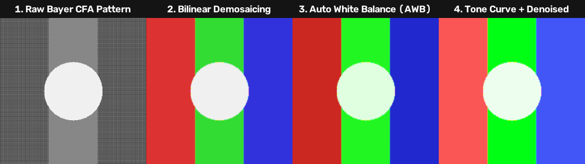
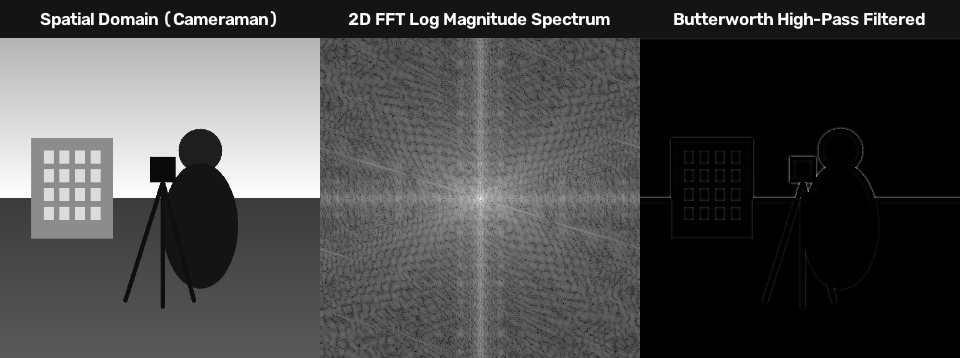
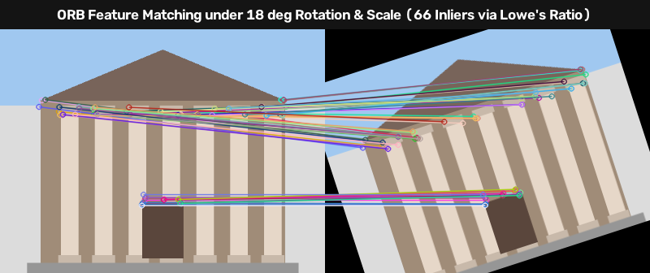
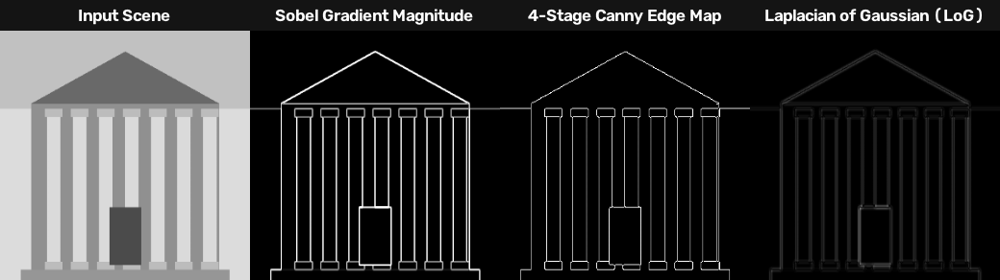
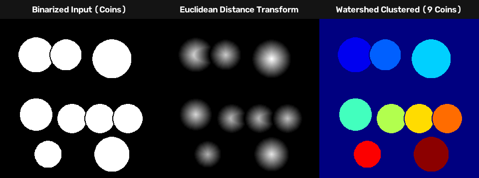
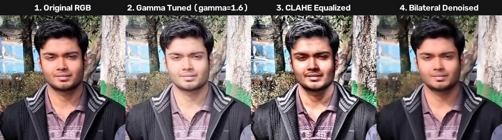
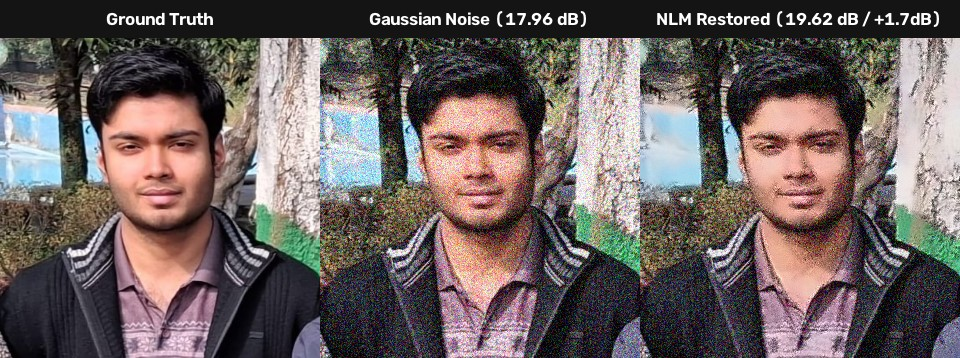
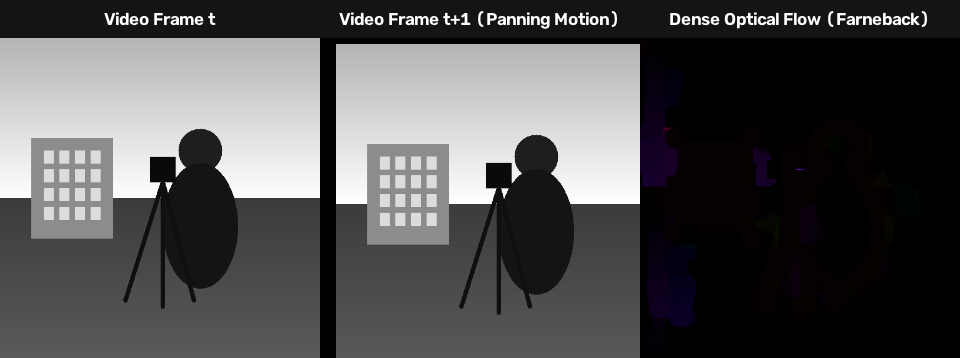

# Image Processing & Computer Vision Portfolio — Sourish Musib

[](https://image-processing-sourish.streamlit.app)
[](https://www.python.org/)
[](https://opencv.org/)
[](https://github.com/sourish-24/image-processing)

A comprehensive classical image processing and computer vision toolkit engineered with **OpenCV**, **NumPy**, **SciPy**, and **Streamlit**. Demonstrates mathematical foundations of spatial and frequency filtering, feature matching, multi-view geometry, temporal video analytics, and hardware **Image Signal Processor (ISP)** pipeline design.

🔗 **Live Web Application:** [image-processing-sourish.streamlit.app](https://image-processing-sourish.streamlit.app)

---

## Visual Transformations & Algorithm Showcases

### 1. Hardware Camera ISP Pipeline Simulation
Simulates the silicon signal processing pipeline inside a digital camera sensor: raw Bayer mosaic readout $\to$ Bilinear Demosaicing $\to$ Black Level Calibration (BLC) $\to$ Gray-World Auto White Balance (AWB) $\to$ Color Correction Matrix (CCM) $\to$ Tone Curve Mapping.



---

### 2. 2D Fourier Transform (FFT) & Frequency-Domain Filtering
Computes the 2D Discrete Fourier Transform (DFT), analyzes centralized frequency distribution on a logarithmic scale, and applies 2nd-order Butterworth high-pass filters to isolate edge boundaries in the frequency domain.



---

### 3. Invariant Feature Matching under Transformation
Extracts scale- and rotation-invariant keypoints using ORB / SIFT, generates binary feature descriptors, and computes correspondence matches across rotated and scaled scenes using Lowe's ratio test ($\text{ratio} < 0.75$).



---

### 4. Multi-Stage Edge Detection
Comparison of first-order gradient operators (Sobel $G = \sqrt{G_x^2 + G_y^2}$), Laplacian second-order derivatives, Laplacian of Gaussian (LoG), and multi-stage Canny hysteresis edge thinning.



---

### 5. Mathematical Morphology & Watershed Segmentation
Applies morphological structuring elements to separate touching binary objects. Computes Euclidean distance transforms to identify marker peaks, followed by watershed flooding to isolate overlapping regions.



---

### 6. Point Operations & Contrast Equalization (CLAHE)
Dynamic range enhancement demonstrating non-linear power-law gamma transfer curves ($\gamma = 1.6$), Contrast Limited Adaptive Histogram Equalization (CLAHE) with localized tile clipping, and bilateral edge-preserving smoothing.



---

### 7. Noise Models & Image Restoration with PSNR / SSIM
Realistic sensor noise modeling (Gaussian, Salt & Pepper, Speckle) and restoration via Non-Local Means (NLM) and bilateral filters, evaluated with Peak Signal-to-Noise Ratio (PSNR) and Structural Similarity Index (SSIM).



---

### 8. Temporal Video Analytics & Dense Optical Flow
Frame-by-frame temporal motion analysis computing dense optical flow vector fields via the Farnebäck quadratic polynomial approximation, visualizing displacement direction and velocity using HSV color mapping.



---

## Progressive 4-Tier Architecture

| Tier | Module | Topic | Core Algorithms & Formulas |
| :--- | :--- | :--- | :--- |
| **Tier 1: Foundations** | **M01** | Point Operations & Histograms | $I_{\text{out}} = c \cdot I + b$, Gamma $\gamma$ correction, CLAHE adaptive equalization |
| | **M02** | Color Space Exploration | RGB $\leftrightarrow$ HSV $\leftrightarrow$ YCrCb $\leftrightarrow$ LAB, Gray-World Auto White Balance |
| | **M03** | Spatial Filtering & Convolution | Gaussian blur, Median, Edge-preserving Bilateral Filter, Unsharp masking |
| **Tier 2: Intermediate** | **M04** | Morphological Operations | Erosion $\ominus$, Dilation $\oplus$, Opening, Closing, Top-Hat, Skeletonization, Watershed |
| | **M05** | Edge Detection | First-order Sobel/Scharr, Second-order Laplacian, LoG, 4-stage Canny Edge Detector |
| | **M06** | 2D Fourier Transform (FFT) | 2D DFT $\mathcal{F}\{f\}$, Gaussian/Butterworth filters, Notch rejection, Hybrid images |
| | **M07** | Noise & Image Restoration | Gaussian, Salt & Pepper, Speckle noise; Non-Local Means (NLM), PSNR/SSIM evaluation |
| **Tier 3: Advanced** | **M08** | Segmentation & Contours | Adaptive Mean/Gaussian, Multi-Otsu, GrabCut GMM segmentation, Contour geometry |
| | **M09** | Features & Keypoint Matching | Harris corner response $R$, ORB binary descriptors, SIFT, Lowe's ratio test matching |
| | **M10** | Geometric Transforms | Affine transformation, 4-point perspective document scanner, Panorama stitching |
| **Tier 4: Production Video & ISP** | **M11** | Video Analytics & Motion | Frame differencing, MOG2 background subtraction, Farnebäck Dense Optical Flow |
| | **M12** | Camera ISP Simulation | Bayer RGGB $\to$ Debayer $\to$ BLC $\to$ AWB $\to$ $3\times3$ CCM $\to$ sRGB Tone Curve $\to$ Mertens HDR |

---

## 🛠️ Installation & Setup

### 1. Activate Virtual Environment

**Windows (PowerShell):**
```powershell
.\.venv\Scripts\Activate.ps1
```

**Linux / macOS:**
```bash
source .venv/bin/activate
```

### 2. Install Dependencies
```bash
pip install -r requirements.txt
```

---

## Running the Interactive Application

Launch the Streamlit web dashboard locally:
```powershell
streamlit run app.py
```

* **Sample images pre-loaded:** Comes pre-loaded with curated benchmark images (`sourish.jpg`, `cameraman.png`, `coins.png`, `building.png`, `noisy_sample.png`, `raw_bayer.png`, `panorama_left.png`, `panorama_right.png`).
* **Custom testing:** Toggle the sidebar to "Upload Custom Image" to test any custom photograph.
* **Download outputs:** Every module includes a direct "Download Result" button.

---

## Running the Automated Test Suite

All algorithms and pipelines are covered by automated unit and integration tests:

```powershell
pytest tests/ -v
```

```text
============================= 51 passed in 3.15s ==============================
```

---

## 📁 Repository Structure

```text
IPCV/
├── .streamlit/                 # Web app theme & server config
├── assets/                     # Visual demonstration figures for README
│   ├── demo_isp_pipeline.png
│   ├── demo_frequency_fft.png
│   ├── demo_feature_matching.png
│   ├── demo_edge_detection.png
│   ├── demo_morphology_watershed.png
│   ├── demo_enhancement.jpg
│   ├── demo_denoising_restoration.jpg
│   └── demo_optical_flow.png
│
├── dataset/                    # Image datasets
│   ├── samples/                # Curated benchmark images & sample generator
│   ├── synthetic/              # 40 synthetic geometric shapes & binary masks
│   └── internet/               # Real-world icon grids & clipart images
│
├── modules/                    # Core algorithm modules (12 topics)
│   ├── m01_point_ops.py        # Module 1: Point Operations & Histograms
│   ├── m02_color_spaces.py     # Module 2: Color Spaces & AWB
│   ├── m03_spatial_filters.py  # Module 3: Spatial Filtering & Convolutions
│   ├── m04_morphology.py       # Module 4: Morphology & Watershed
│   ├── m05_edge_detection.py   # Module 5: Sobel, Canny, LoG
│   ├── m06_frequency_domain.py # Module 6: 2D FFT & Frequency Filtering
│   ├── m07_noise_restoration.py# Module 7: Noise Models & PSNR/SSIM
│   ├── m08_thresholding_seg.py # Module 8: Adaptive, Multi-Otsu, GrabCut
│   ├── m09_features.py         # Module 9: Harris, ORB, SIFT Keypoints
│   ├── m10_transforms.py       # Module 10: Perspective & Panorama Stitching
│   ├── m11_video.py            # Module 11: Optical Flow & Background Subtraction
│   └── m12_isp_pipeline.py     # Module 12: Camera ISP Pipeline Simulation
│
├── tests/                      # Pytest test suite (51 test cases)
├── app.py                      # Interactive Streamlit Web Application
├── requirements.txt            # Python dependencies
└── README.md                   # Project documentation
```
